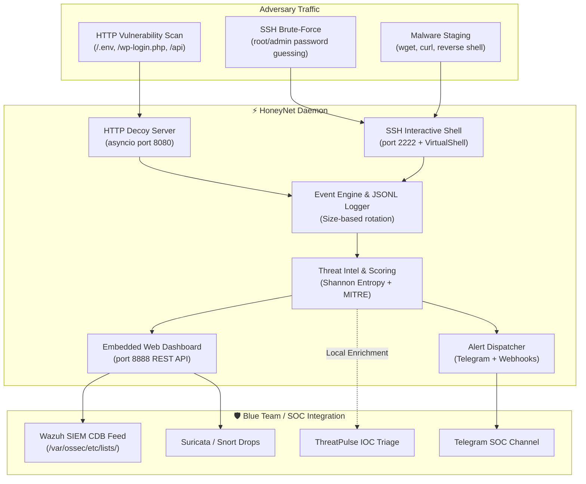

# ⚡ HoneyNet — Multi-Vector Low-Interaction Honeypot & SOC Telemetry Engine

[](https://www.python.org/)
[](https://opensource.org/licenses/MIT)
[](https://attack.mitre.org/)
[](https://wazuh.com/)
[](https://pypi.org/project/threatpulse-cli/)
[-success.svg)]()

> **HoneyNet** is a production-grade, multi-vector low-interaction honeypot daemon designed for SOC monitoring, threat intelligence gathering, and dynamic intrusion prevention. It emulates deceptive HTTP portals, vulnerable APIs, and interactive SSH shells to bait adversaries, harvest credentials, calculate threat scores, and generate automated **Wazuh CDB / Suricata rules** in real time.

---

## 🏛️ Architecture & Ecosystem Workflow



---

## 🚀 Key Capabilities

- **Zero-Dependency Core**: HTTP honeypot, event logging, threat scoring, and web dashboard run entirely on Python's standard library (`asyncio`, `urllib`, `dataclasses`). Paramiko is optional only for live SSH protocol emulation.
- **Multi-Vector Decoys**:
  - **HTTP Honeypot**: Decoy corporate SSO login portal, sensitive file leakage traps (`/.env`, `/.git/config`, `/.aws/credentials`), Spring Boot `/actuator`, WordPress `/wp-login.php` & `/xmlrpc.php`, and web shell backdoors.
  - **SSH Honeypot & Virtual Shell**: Interactive isolated terminal (`VirtualShell`) providing believable outputs for `whoami`, `id`, `uname -a`, `cat /etc/passwd`, `cat /home/deploy/.env`, while capturing malware staging commands (`wget`, `curl`, `chmod +x`).
- **Real-Time Threat Intelligence & Scoring (0–100)**:
  - Shannon Entropy calculation $H(X)$ on passwords and probe paths.
  - Bogon & RFC 1918 internal IP filtering to dampen scores on internal tests.
  - Automatic MITRE ATT&CK technique mapping (`T1190`, `T1110.001`, `T1005`, `T1082`, `T1105`).
- **Dynamic SIEM & Firewall Integration**:
  - Generates instant **Wazuh CDB records** (`<ip>:<severity>:<mitre_id>:block`) ready for `/var/ossec/etc/lists/`.
  - Generates **Suricata/Snort drop rules**.
- **Real-Time Embedded Web Dashboard**:
  - Dark-themed cyberpunk SOC dashboard at `http://127.0.0.1:8888`.
  - Live attack stream feed with 3-second auto-polling.
  - Intercepted credential leaderboard (wordlist generation).
- **Multi-Channel Alert Dispatcher**:
  - Formatted Telegram Bot alerts and SIEM webhooks with per-IP rate-limiting (30s default) to prevent alert storms.

---

## ⚙️ Quick Start

### 1. Installation

```bash
git clone https://github.com/Voobrazhenie21-lab/honeynet.git
cd honeynet

# Create virtual environment & install
uv venv
uv pip install -e ".[ssh,test]"
```

### 2. Run the Daemon

```bash
# Start all honeypot decoys and web dashboard
python -m honeynet run
# or: honeynet run
```

```text
[+] HTTP Decoy active on http://0.0.0.0:8080
[+] Web Dashboard active at http://127.0.0.1:8888
[+] SSH Decoy active on 0.0.0.0:2222
[+] HoneyNet daemon running. Press Ctrl+C to terminate gracefully.
```

### 3. Access the SOC Dashboard

Open **`http://127.0.0.1:8888`** in your browser to inspect live attacks, telemetry metrics, and auto-generated CDB rules.

---

## 🛠️ CLI Reference

| Command | Description |
| :--- | :--- |
| `honeynet run` | Starts the HTTP honeypot, SSH decoy, and Web Dashboard. |
| `honeynet status` | Displays total events, unique adversary IPs, and recent threats. |
| `honeynet export-wazuh -o blacklist.cdb` | Dumps auto-generated Wazuh CDB records to a file. |
| `honeynet test-alert` | Simulates an intrusion and verifies Telegram/Webhook delivery. |

---

## 🛡️ Wazuh SIEM Integration Guide

HoneyNet natively generates Wazuh CDB list entries. To integrate:

1. Export dynamic rules:
   ```bash
   honeynet export-wazuh -o /var/ossec/etc/lists/honeynet_blacklist
   /var/ossec/bin/wazuh-makelists
   ```

2. Add CDB list reference in `/var/ossec/etc/ossec.conf`:
   ```xml
   <ossec_config>
     <ruleset>
       <list>etc/lists/honeynet_blacklist</list>
     </ruleset>
   </ossec_config>
   ```

3. Add correlation rule in `/var/ossec/etc/rules/local_rules.xml`:
   ```xml
   <group name="honeynet,attack,">
     <rule id="100300" level="10">
       <list field="srcip" lookup="address_match_key">etc/lists/honeynet_blacklist</list>
       <description>HoneyNet: Intercepted adversary IP probing perimeter decoys</description>
       <mitre>
         <id>T1190</id>
       </mitre>
     </rule>
   </group>
   ```

---

## 🐳 Docker Deployment

```bash
# Build & run isolated container
docker build -t honeynet-soc .
docker run -d -p 8080:8080 -p 2222:2222 -p 8888:8888 --name honeynet honeynet-soc
```

---

## 🧪 Testing

```bash
pytest -v
```

---

## 📄 License

Distributed under the **MIT License**. Created by [Aleksei Zharkou](https://github.com/Voobrazhenie21-lab).
